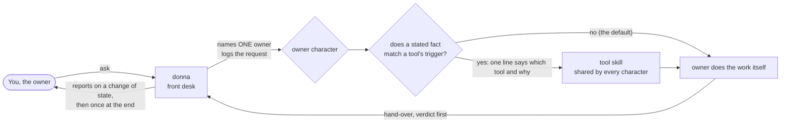
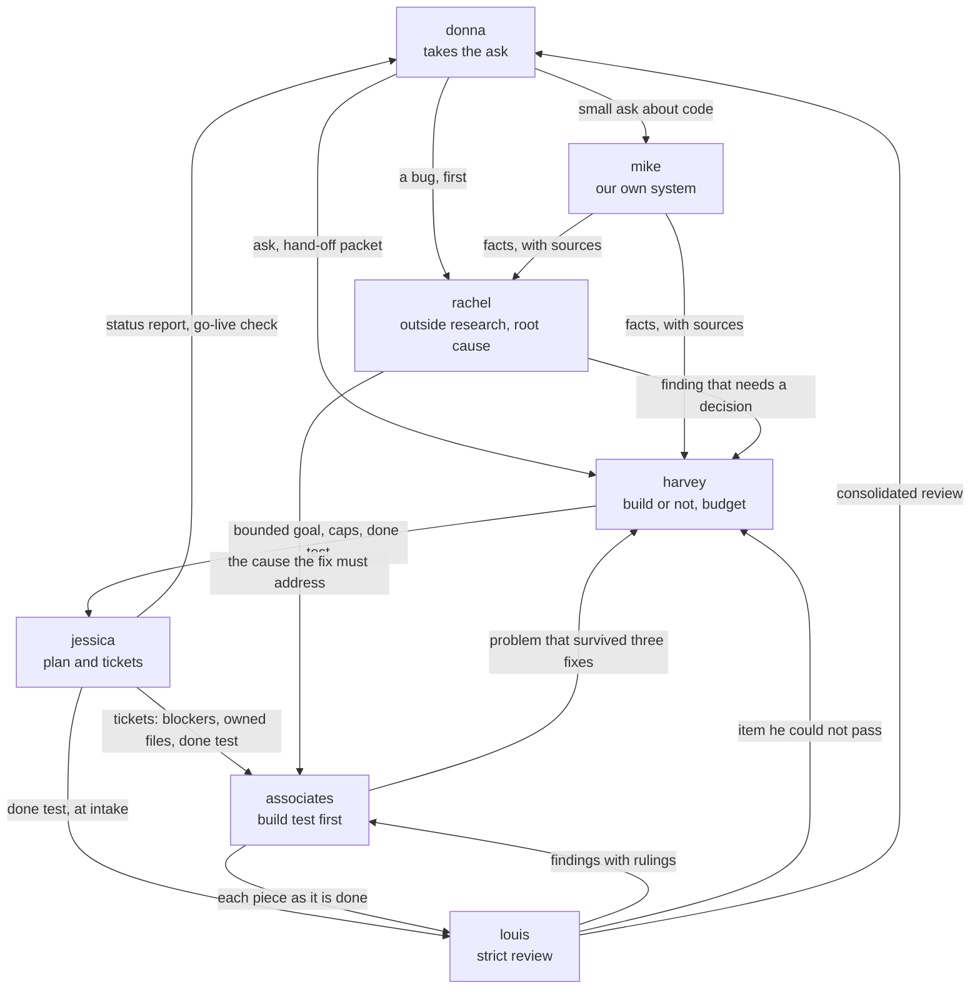
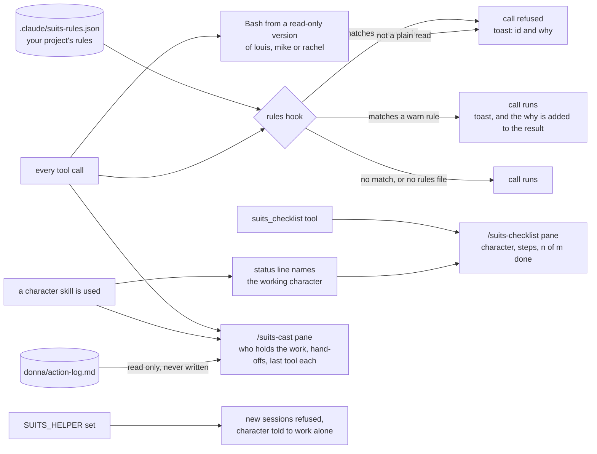

# Suits

**S**ome **U**nusually **I**ntelligent **T**eam **S**pecialists.

A set of specialist skills for Claude Code. Each character has its own job and voice, and calls shared tools only when a task needs them. Ask for something and donna names the one character who owns it.

## Quick start

```text
/plugin marketplace add Seuketchi/suits
/plugin install suits@suits
```

Start a new session so the slash commands register. Then ask, in plain words:

- `/suits:donna Draft a reply to the vendor about the late delivery.` A document or email, written up and never sent.
- `/suits:mike What does the retry logic in the payment client do today?` What our own code does, with `file:line` references.
- `/suits:louis Review this diff against the spec.` Findings, each with a ruling.

Not sure who to ask? Ask donna. She names the owner.

## How it works

A request reaches donna, the front desk. She names one owner and writes the request down. The owner calls a tool only when a stated fact about the task matches that tool's trigger. The default is not to call.



Work that spans characters moves by hand-off, one packet at a time, never copied:



Each character's own page lists exactly who it takes work from and hands work to.

### The mod

The plugin also ships a small mod in [hooks](./hooks). The decisions are in `logic.mjs` and `readonly.mjs`, and the wiring is in `register.tsx`. A project's rules come only from its own rules file. The one rule of the plugin's own holds the read-only versions of louis, mike and rachel to reading.



## The team

| Character | Role | Call them for |
| --- | --- | --- |
| **donna** | Front desk and secretary | A request that needs an owner and a record; documents, emails, briefs, minutes, decks, a pull request body. Drafts and tracks; never sends or signs. |
| **jessica** | Project manager | A plan, tickets with blockers and owned files, a status report, risks, go-live readiness. |
| **harvey** | Senior judgement | Whether to build, the budget, a pitch or negotiation, validating a finding that changes scope, money or a rule. |
| **mike** | Our own system | What the code does today and what was decided before. |
| **rachel** | Outside research | An external fact, a literature question, or a bug's root cause before anyone looks for the line to change. |
| **louis** | Strict review | A diff to check against the rules and the spec, with numbers checked; rules on every review comment. |
| **the associates** | The builders | Implementing a ticket or fixing a bug, test first, each owning its own files. |

<details>
<summary>What the names stand for</summary>

| Character | Stands for |
| --- | --- |
| donna | **D**oesn't **O**verlook **N**or **N**eglect **A**nything |
| jessica | **J**ust **E**nsure **S**chedules **S**tay **I**n **C**heck **A**lways |
| harvey | **H**aggles **A**nd **R**arely **V**acates **E**very **Y**ard |
| mike | **M**aybe **I** **K**now **E**verything |
| rachel | **R**arely **A**ccepts **C**laims **H**unting **E**very **L**ead |
| louis | **L**et **O**nly **U**nimpeachable **I**tems **S**hip |
| the associates | **A**lways **S**hipping **S**mall **O**bviously **C**orrect **I**ncrements **A**fter **T**esting **E**very **S**tep |

</details>

The team may grow.

## The tools

Each tool is its own skill. It is never copied into a character, so improving a tool improves every character that calls it. The one-line description of each is in [skills/tools](./skills/tools/README.md).

### User-invoked

- `retro`: started by the owner, offered by jessica.

### Model-invoked

- `code-review`: called by louis.
- `codebase-design`: called by harvey.
- `critical-path`: called by jessica.
- `diagnosing-bugs`: called by associates.
- `domain-modeling`: called by mike.
- `findings`: called by mike, rachel.
- `go-live-check`: called by jessica.
- `grilling`: called by harvey.
- `handoff`: called by donna.
- `improve-codebase-architecture`: called by harvey.
- `money-check`: called by louis.
- `morning-brief`: called by donna.
- `negotiation-prep`: called by harvey.
- `pitching`: called by harvey.
- `pr`: called by donna.
- `prototype`: called by associates.
- `raid-log`: called by jessica.
- `recall`: called by mike.
- `research`: called by rachel.
- `reverse-engineer-anything`: called by mike.
- `root-cause-audit`: called by rachel.
- `scrum`: called by donna, jessica.
- `security-review`: called by louis.
- `senior`: called by harvey.
- `slides`: called by donna.
- `source-finder`: called by rachel.
- `status-report`: called by jessica.
- `stocktake`: called by mike.
- `tdd`: called by associates.
- `test-kitchen`: called by mike.
- `to-spec`: called by jessica.
- `to-tickets`: called by jessica.

## Mods

<details>
<summary>Project rules, the checklist pane, the cast board and helper mode</summary>

Hooks on tool calls enforce a project's own rules. Apart from the read-only rule for its own read-only versions, Suits carries no rules of its own. A project lists them in `.claude/suits-rules.json`, found from the folder the session starts in up to the git root:

```json
{
  "never": [
    { "id": "no-deploy-config", "why": "deploy-config is changed only by its own owners", "tools": ["Edit", "Write", "Bash"], "match": "deploy-config" }
  ],
  "warn": [
    { "id": "one-heavy-test", "why": "two full test runs exhaust the shared test database", "tools": ["Bash"], "match": "\\b(mvn|gradle)\\b.*\\btest\\b" }
  ]
}
```

- `match` is a regular expression tested against the tool call's input: the file path for Edit, Write and Read, the command for Bash, the input as JSON for any other tool. `tools` is optional; left out, the rule covers every tool.
- A `never` match is refused: the call is denied with `<id>: <why>` and a toast says so. A `warn` match runs, a toast says so, and the `why` is added to the tool's result.
- `match` runs on every tool call, so keep it simple. A long input is tested after a 4096-character cut, and a pattern that repeats a group that already repeats, such as `(a+)+$`, is refused as a bad rule. That check is not full protection: slow patterns such as `(a|a)+$` or `a+a+a+$` get through and can freeze every tool call, so keep `match` simple.
- With no rules file, every call passes. A file that is not valid JSON, or that exists but cannot be read, is reported once and none of its rules apply. A single bad rule is reported once and dropped alone; the valid rules in the same file stay in force.
- If a check itself fails, the call goes through and a toast says it was not checked.
- `/suits-rules` shows the file and its rules, or says there is none.

### Checklist


For a job of three or more steps, a character lists the steps with the `suits_checklist` tool: `steps` sets the list, `done` marks step numbers (from 1) done. `/suits-checklist` opens a pane that shows the working character, each step as done or left, and "n of m done". The pane opens only when asked, and it seats at any width. Nothing else opens it.

### Cast board

`/suits-cast` opens a pane that shows who holds the work: the character holding it now, the hand-offs so far in order (`harvey → mike`), and the last tool each character called (`Bash`, `Edit`, `/suits:tdd`). It is fed by tool calls and skill prompts as they happen, so it fills as a job runs; a call made inside a delegated task is credited to the character holding that task. The pane opens only when asked, and nothing else opens it.

The board is kept for the session only. Nothing is written to disk, and a failure in the board never stops or changes a tool call.

When the project has `donna/action-log.md`, the pane also shows a count by status and the actions that are still open or parked, and it reads the file again when a tool call edits it. The log is looked for from the folder the session starts in up to the git root, nearest first, at that path only. The mod reads it and never writes it.

### Helper mode


A session that must do its work alone, with no new session started, is a helper. One variable turns helper mode on: `SUITS_HELPER`, any value but empty or `0`. It is the only variable the mod reads, and it is read at each event, not once at start.

- Starting a session is refused with "This session is a helper: do the work yourself in one pass (Working alone).", and a toast says so.
- The system prompt gains one line pointing the character at its **Working alone** section.
- The status line shows the working character when a character skill is used (`louis`), and `louis · helper` in helper mode. In helper mode with no character yet it shows `helper`. A tool skill does not change it.

Nothing in this plugin sets the variable. Whatever starts a helper sets it: put `SUITS_HELPER=1` in the environment of the session it launches, or have a mod of its own call `$.env.set("SUITS_HELPER", "1")` in a `session.start` hook, which sets it for the whole process.

</details>

## Layout

- [skills/characters](./skills/characters/README.md): the characters.
- [skills/tools](./skills/tools/README.md): the tools they call.
- [agents](./agents): the read-only versions of louis, mike and rachel.
- [hooks](./hooks): the mod, with its decisions in `logic.mjs` and `readonly.mjs`.
- [docs](./docs): one page per skill, and the decisions in [docs/adr](./docs/adr).

## Checks

`npm run check-skills` checks the listing rules, the docs pages, the links and `claude plugin validate`. `npm test` runs the character, donna and mod tests; `claude plugin test .` runs the mod against the real hook engine. CI runs both on every pull request.

Rules for working here are in [CLAUDE.md](./CLAUDE.md). The words this repo uses are in [CONTEXT.md](./CONTEXT.md).
