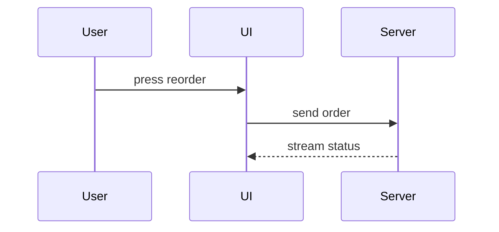

Write the body of a pull request in three parts, in this order:

```markdown
## Summary

<a diagram, a diff sketch or a tree>

## Evidence

- **Before:** <screenshot, output or failing test run>
  **After:** <screenshot, output or passing test run>

## Merge Danger

**Door:** <one-way or two-way>

<optional: a line on why>

**Blast Radius:** <one word>

<optional: what could follow from merging>
```

Skip any preamble and keep the prose short. Use the project's own words from `CONTEXT.md` when it has one. Write it in the plain professional register.

## Summary

Pick the smallest view that makes the main point clear. Put each view next to the one line of text it supports, and keep only the calls, files, states and boundaries the reader needs to follow the change. Use one view, sometimes two, and rarely more.

Logic or an algorithm, as pseudocode:

```text
on(save)
  if content is unchanged
    return cached result
  write new content
  return fresh result
```

Runtime control flow, as a call tree:

```text
placeOrder
  reserveStock
    checkWarehouse
    holdItems
  confirmPayment
```

Screen structure, as a component tree with the files, state and module boundaries that matter:

```text
<OrderPage> (apps/shop/src/routes/order.tsx)
  useOrderEvents()
  <OrderToolbar>
    <ReorderButton> (packages/ui)
```

File responsibility or a broad refactor, as a shallow file tree:

```text
src/
├── commands/       # parses user actions
├── orders/         # owns order state
└── transport/      # sends API requests
```

Interaction between parts, or data flow, as a Mermaid diagram:



When the point is what changed and the surrounding shape already exists, use a `diff` in the same shape as the topic. For a component change:

```diff
 <OrderPage>
   useOrderEvents()
   <OrderToolbar>
+    <ReorderButton />
   <OrderTimeline>
+    <StatusCard />
```

For a file layout change:

```diff
 src/
 ├── commands/
+│   └── reorder.ts       # expands the reorder command
 ├── orders/
-└── transport.ts
+└── transport/
+    ├── client.ts
+    └── stream.ts
```

For a call tree:

```diff
 placeOrder
   reserveStock
     checkWarehouse
+    expireOldHolds
   confirmPayment
-  sendReceipt
+  sendReceipt
+    queueEmail
```

For a change in control flow:

```diff
 on(save)
-  write content
+  if content is unchanged
+    return cached result
+  write new content
+  invalidate cache
```

When most of the block is new, when leaving out context would hide who owns what or the order, or when the reader needs a target shape to copy, show the whole block:

```ts
function expandCommand(command: string): string {
  const name = command.slice(1);
  return `run the ${name} command`;
}
```

## Evidence

Show that the change works, with a before and after.

- A screenshot is the best proof when the change is visual and the environment can take one.
- Test results or console output come next. Show the exact test that failed before and passes now, in pseudocode.

## Merge Danger

Say whether the door is one-way or two-way. A two-way door can be walked back, so a change that is cheap to roll back is lower risk. A change that destroys data or cannot be undone is a one-way door.

The blast radius is how far the change reaches if it is wrong: a layout shift, a break for the people who call this code, a small screen. Weigh every case.
